# Bio

- Speak: ***English (UK & US), Russian***
- Programmer & Game developer
- Have been programming for 6 years
  

Programming languages
---
<a href="https://python.org/">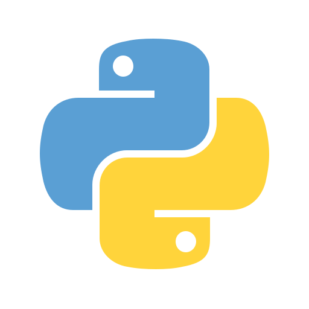</a>
<a href="https://isocpp.org/">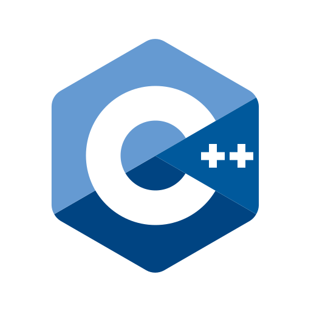</a>

<a href="https://www.lua.org/">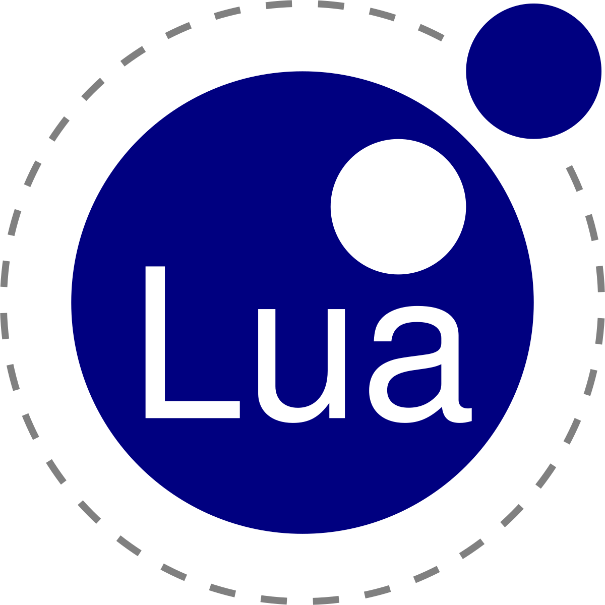</a>

Web 
---
<a href="https://html.spec.whatwg.org/multipage/">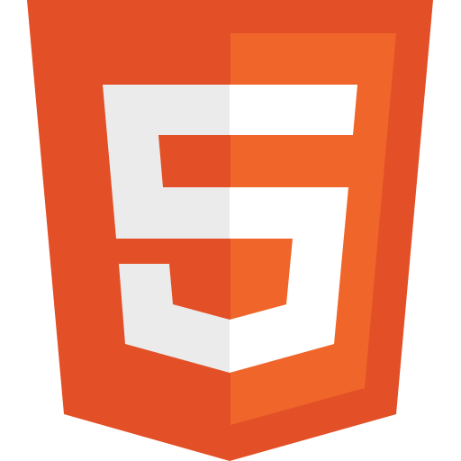</a>
<a href="https://www.w3.org/Style/CSS/">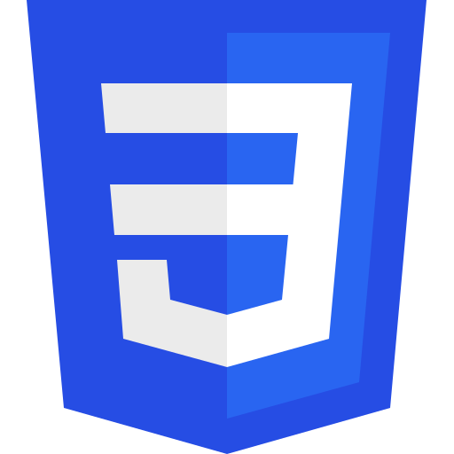</a>

<!--Libraries
---
placeholder for now

Other
---
placeholder for now -->

 # Learning
<a href="https://rust-lang.org/">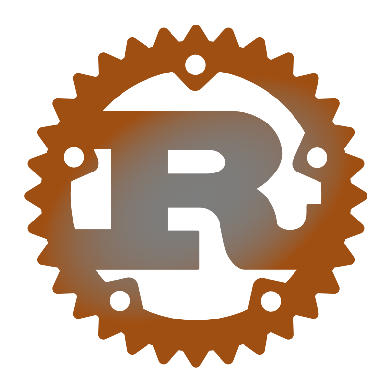</a>

<a href="https://www.opengl.org/">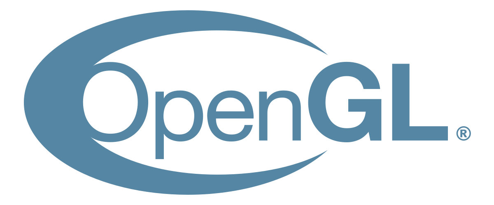</a> 
<a href="https://www.php.net/">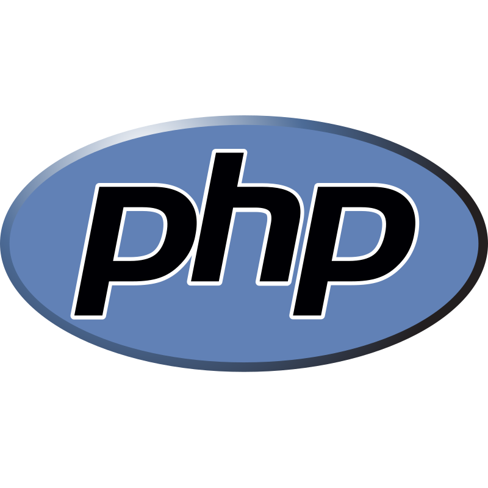</a>

# Game dev
<a href="https://www.clickteam.com/clickteam-fusion-2-5">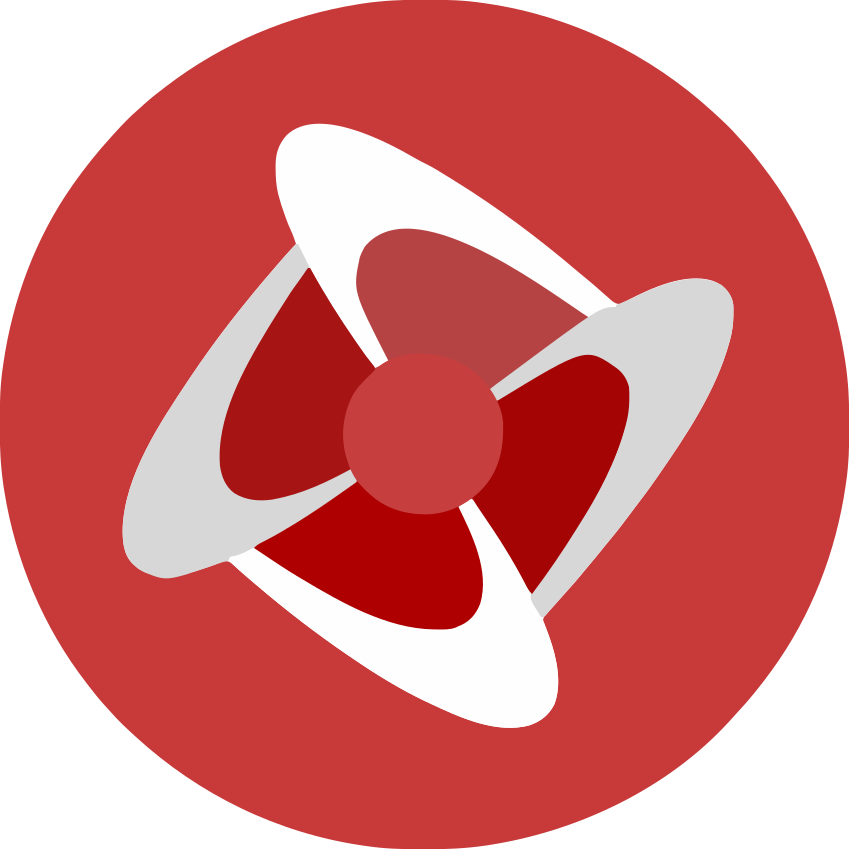</a>
<a href="https://pygame.org">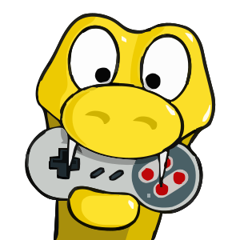</a>
<a href="https://www.ursinaengine.org/">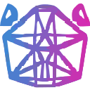</a>
<a href="https://www.construct.net/en/construct-2">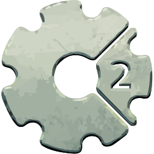</a>
<a href="https://www.construct.net/en/">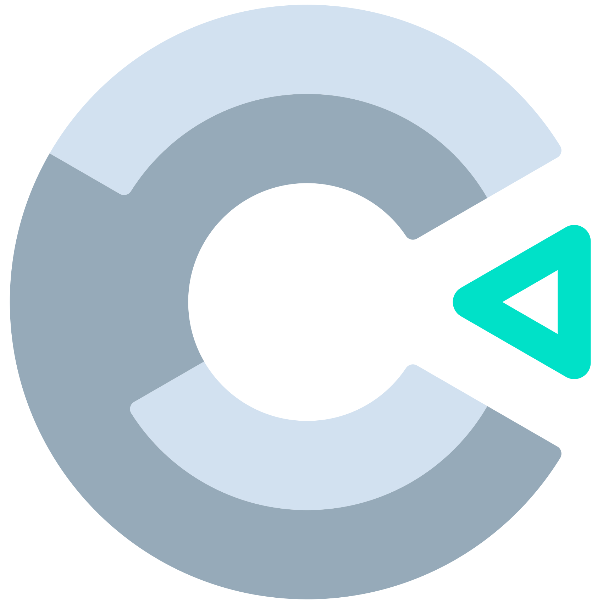</a>
<a href="https://www.love2d.org/">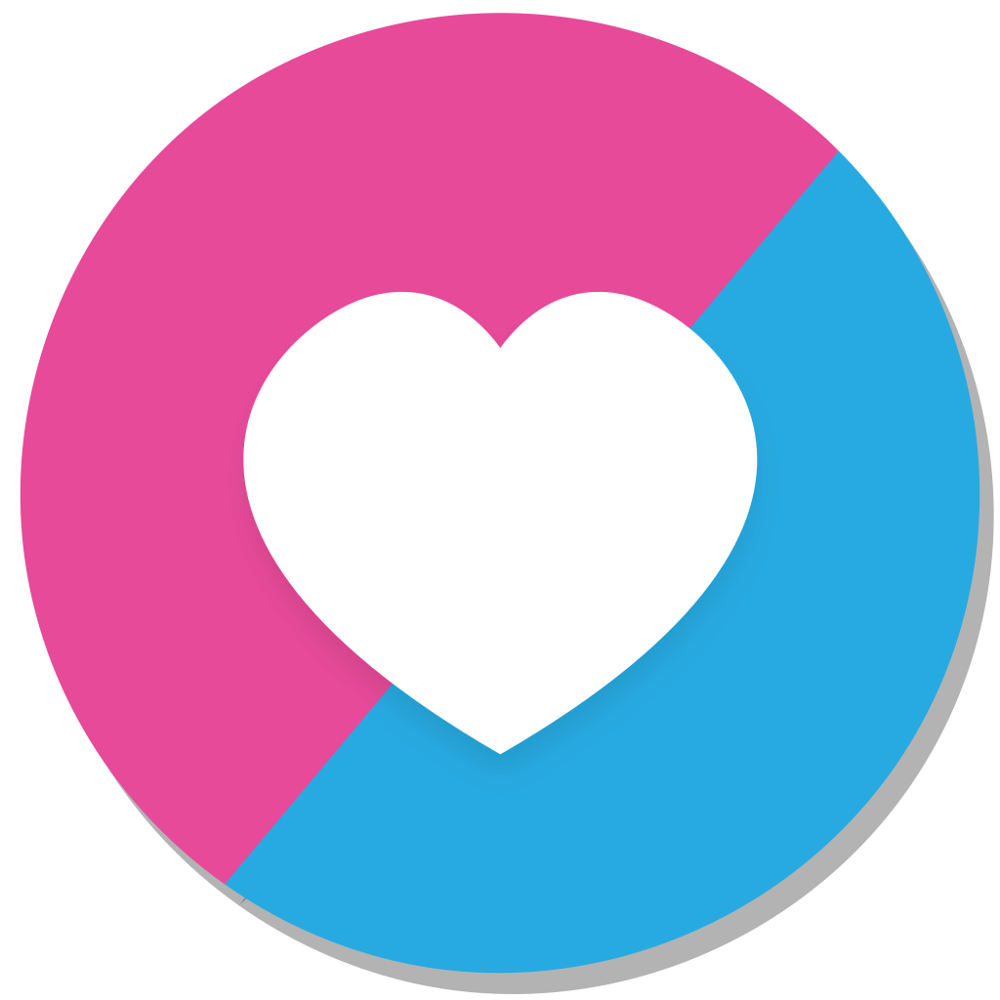</a>
<a href="https://www.raylib.com/">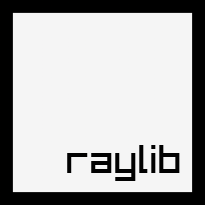</a>

# Work with
<a href="https://support.microsoft.com/en-us/windows">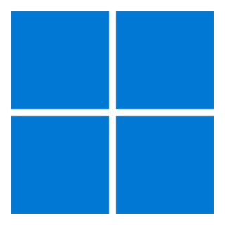</a>
<a href="https://kernel.org/">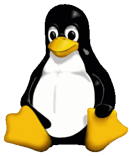</a>
<a href="https://www.android.com/">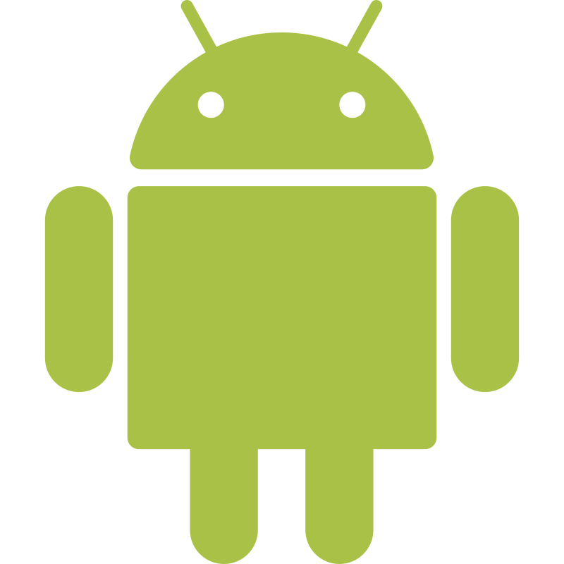</a> 

# Homebrew development
<picture>
 <source media="(prefers-color-scheme: dark)" srcset="assets/psp-white.svg"> <!-- white icon for dark theme -->
     
<a href="#">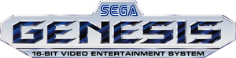</a>

</picture> <!-- black icon for white theme -->
    

<!--
# Theme icons test
<picture>
 <source media="(prefers-color-scheme: dark)" srcset="assets/psp-white.svg"> <!-- white icon for dark theme -->
<!--  <!-- black icon for white theme -->
<!--</picture> --!>

