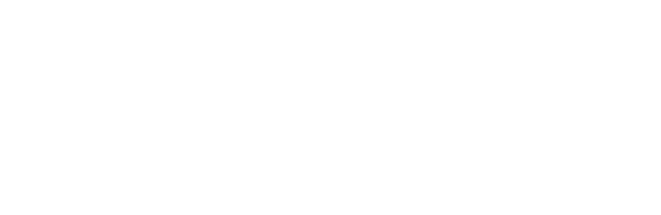

# Bio

- Speak: ***English (UK & US), Russian***
- Programmer & Game developer
- Have been programming for 6 years
  

Programming languages
---

Web 
---

<!--Libraries
---
placeholder for now

Other
---
placeholder for now -->

 # Learning

 

# Game dev

# Work with

# Homebrew development
<picture>
 <source media="(prefers-color-scheme: dark)" srcset="assets/psp.svg"> <!-- white icon for dark theme -->
     <!-- black icon for white theme -->
</picture>

<!--
# Theme icons test
<picture>
 <source media="(prefers-color-scheme: dark)" srcset="assets/psp-white.svg"> <!-- white icon for dark theme -->
<!--  <!-- black icon for white theme -->
<!--</picture> --!>

